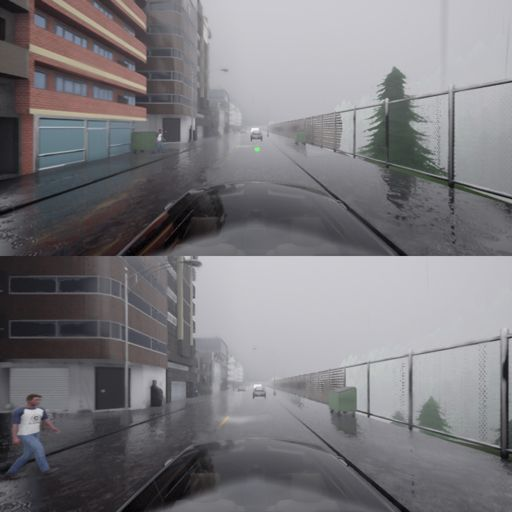

# A pedestrian crossing from the left hangs or crawls the simulator

Investigated 2026-10-15 (Chris). Short version: Bench2Drive's
`DynamicObjectCrossing` with `direction: left` places its pedestrian by
stepping sideways one lane at a time until it finds a sidewalk. On a two-way
road that walk crosses the centre line and then bounces between the two
centre lanes forever. Depending on when the scenario is built, the route
either hangs at setup or drives at about 1/50 of normal speed until the task
limit. A 10-line patch fixes it and was verified on two public routes.

## Symptom

Two forms, same cause:

| When the scenario is built | What you see | Measured |
|---|---|---|
| During route setup (`RouteScenario.__init__`) | The run stops after "Loading the world"; no simulation step is ever taken; our launcher kills the evaluator after 900 s of silence | Bench2Drive routes 24211 and 24224 with the crossing set to `left`, job 40012526 |
| Later, by the leaderboard's scenario-builder thread | The car drives, but at a real-time factor of 0.001 to 0.002 (one simulator step every 5 to 45 s) instead of 0.08 to 0.10; the GPU idles at about 3%, the policy process sits at 100% of one CPU core | Six routes on 2026-10-15 (`docs/WHAT_BROKE.md`), on three different nodes |

The second form is the expensive one. It looks like a slow or bad node, and it
runs until the Slurm time limit. It was first misread as two bad A40 nodes,
which were excluded and then reinstated once the same split showed up on a
third node, with a normal route running beside each slow one on the same GPU.

## Mechanism

1. **The walk.** `DynamicObjectCrossing._initialize_actors`
   (`scenario_runner/srunner/scenarios/object_crash_vehicle.py`) moves 20 m or
   so ahead of the trigger point, then:

   ```python
   while sidewalk_waypoint.lane_type != carla.LaneType.Sidewalk:
       side_wp = sidewalk_waypoint.get_right_lane() if right else sidewalk_waypoint.get_left_lane()
       if side_wp is None: break
       sidewalk_waypoint = side_wp
   ```

   There is no step limit.
2. **Lanes are directional.** In OpenDRIVE, lane ids change sign at the centre
   line and lanes on the other side face the other way. `get_left_lane()` is
   relative to the lane's own direction. From the ego lane (id −1), left is the
   oncoming lane (+1). From the oncoming lane, left is back toward the ego lane
   (−1). The walk goes −1, +1, −1, ... and never reaches a sidewalk. To the
   right this cannot happen, because right always points away from the centre.
3. **The thread.** The leaderboard retries unbuilt scenarios once a second in a
   background thread (`scenario_manager.build_scenarios_loop`). A loop that never
   returns there never raises, so the scenario is neither built nor skipped.
   Each call into the CARLA client briefly releases Python's global interpreter
   lock, so the main loop still ticks, but only in the gaps. That is the 0.002×
   crawl. Built during setup instead, on the main thread, the same loop is a
   plain hang.

Upstream's own `VehicleTurningRoutePedestrian` (`object_crash_intersection.py`)
does this correctly: it collects the oncoming lanes first and walks right from
the outermost one.

## How common it is (measured)

`scripts/lane_walk_probe.py` reproduces the walk at every scenario trigger
point in a routes file. It needs only a CARLA server; this one ran with
`-nullrhi` on a CPU node in under 10 minutes (jobs 40010475 and 40012549), at
negligible cost.

| Trigger points | Stock walk, right | Stock walk, left | Fixed walk, left |
|---|---|---|---|
| Bench2Drive-220, 220 points | 132 sidewalk, 88 road edge | **166 cycle**, 51 edge, 3 sidewalk | 124 sidewalk, 96 edge, 0 cycle |
| SimLingo training routes, 4,629 points | 2,688 sidewalk, 1,941 edge | **3,885 cycle (84%)**, 537 edge, 207 sidewalk | 2,580 sidewalk, 2,049 edge, 0 cycle |

So `left` hangs at three out of four places one might put it. The benchmark
never notices: all five of Bench2Drive-220's `DynamicObjectCrossing` routes use
`right`. Any new route that sets `left` on a two-way road will hit this.

## Fix

`adapters/simlingo/patches/left-crossing-walk.patch`. When the walk crosses the
centre line (the lane id changes sign), it continues with the opposite call, so
it keeps moving away from the ego. From there on it treats the crossing as
coming from the right, in the far lanes' own frame. The walker is then placed
with `previous()` instead of `next()`, since the far sidewalk runs against the
ego's direction, and this keeps the walker beyond its blocker. On roads with no
oncoming lane the behaviour is unchanged.

**Verified (job 40013275, patched runtime).** Routes 24211 (Town01) and 24224
(Town02) with `left`:
- both drove at a real-time factor of 0.086 and 0.083;
- both spawned their walker, which came within 4.3 m and 4.2 m of the car;
- both finished with driving score 100 in under 8 minutes.

The walker stands by its blocker on the far sidewalk, then steps into the
oncoming lane (frames 160 and 180 of route 24211):



From the far side the walker has further to go, so on both routes the car had
passed before the walker reached its lane. Whether a far-side crossing is
dangerous is a separate question from whether it runs.

**Applied 2026-10-19 to Chris's runtime** (`christophervu/hri/.runtime`, which
his clones share), with Jerry's agreement in the 10-18 split. The test before
that used a private copy (`hri-dev/.runtime-dev`). It changes no existing route
(none sets `left` on a two-way road), but it is a change to pinned benchmark
code, so any other runtime needs it applied too:

```bash
git -C .runtime/simlingo apply ../../adapters/simlingo/patches/left-crossing-walk.patch
```

## The same flaw elsewhere

- `construction_crash_vehicle.py`, `_spawn_side_prop`: walks sideways while the
  lane is Driving or Parking. With `direction: left` on a two-way road it would
  bounce the same way, since the oncoming lane is also Driving. Training routes
  use `left` 15 times, all at points where the walk ends at a road edge.
  Unpatched, untested.
- `object_crash_intersection.py`: correct, as noted above.

## Prevention

- **A watchdog on simulation speed.** A route below a real-time factor of 0.01
  after 10 minutes is this failure, or something like it. Stopping it then
  saves about 2 h 50 m per route at a 3-hour limit. Our launcher already stops
  an evaluator that is *silent* for 15 minutes, which catches the first form
  but not the second.
- **Probe new scenario parameters before a pilot.** Running the probe over a
  generated routes file costs minutes of CPU and would have flagged every
  affected route before any GPU time was spent.
- **Do not trust "the node is slow".** The tell was a normal route and a
  crawling one sharing one GPU, and the crawling ones all sharing one
  configuration value.
